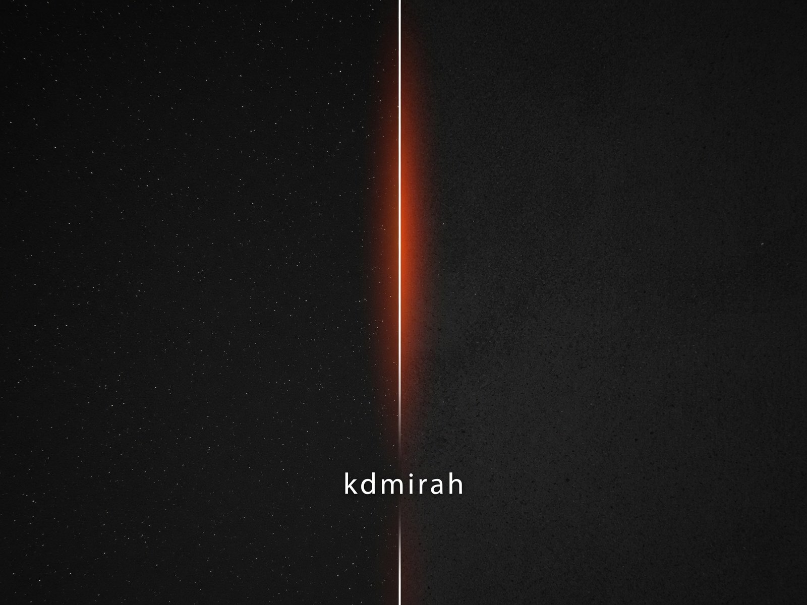

# aimirah.me

This repository contains two React sites: the live kdmirah Digital Inspiration Lab and a separate MI4Inc. motion study.

[](https://aimirah.me/)
[](https://clone-string-tune-website-gold.vercel.app/)
[](https://react.dev/)
[](https://vite.dev/)
[](LICENSE)

## Sites

| Directory | Site | What it shows |
| --- | --- | --- |
| [`clone-reframed-online-website/`](clone-reframed-online-website/) | [aimirah.me](https://aimirah.me/) | Four source-to-output design experiments with draggable image comparisons. |
| [`clone-string-tune-website/`](clone-string-tune-website/) | [MI4Inc. study](https://clone-string-tune-website-gold.vercel.app/) | An interactive landing page exploring motion, scroll, and a pluckable string. |

The MI4Inc. study is a separate deployment. It does not replace the Digital Inspiration Lab at `aimirah.me`.



## Digital Inspiration Lab

The lab follows an idea from a visual reference to its designed result. Each full-screen pair places the source beneath the result. Drag the seam to compare them. The seam also responds to left and right arrow keys when focused.

The four studies live in [`src/lib/data.ts`](clone-reframed-online-website/src/lib/data.ts):

| Study | Source | Result |
| --- | --- | --- |
| Concrete Rhythm | Raw concrete facade | Modular poster system |
| Liquid State | Ink in water | Flow-field hero concept |
| Light Currents | Long-exposure fibre trails | Data interface |
| Fault Lines | Dried-earth topography | Editorial spread |

A preloader, section navigation, animated manifesto, marquees, starfield, and film grain frame the comparisons. Lenis handles smooth scrolling. The introductory seam animation respects `prefers-reduced-motion`.

## MI4Inc. motion study

The second app contains a scroll-driven landing page with a pluckable string, moving leaves, a masonry section, and motion-technique panels. Its images and KHTeka fonts live in [`src/assets/`](clone-string-tune-website/src/assets/). The images and fonts originated from [Fiddle.Digital's StringTune site](https://string-tune.fiddle.digital/). The repository owner authorized their use in this deployment. Check the rights for those assets before reusing them elsewhere.

The study is a site demonstration. Its copy describes a motion system, but this repository does not publish a reusable StringTune library.

## Stack

Both apps use React 19, TypeScript, Vite 7, Tailwind CSS 4, Lenis, and `vite-plugin-singlefile`. Each production build produces an inlined `dist/index.html`. Site images remain under their respective `public/` or `src/assets/` directories.

## Run locally

Install [Node.js](https://nodejs.org/) and npm. Vite 7 requires Node.js 20.19+ or 22.12+.

```bash
git clone https://github.com/strdst7/aimirah.me.git
cd aimirah.me/clone-reframed-online-website
npm ci
npm run dev
```

Open the local URL printed by Vite. To run the MI4Inc. study instead, use its directory:

```bash
cd ../clone-string-tune-website
npm ci
npm run dev
```

Run the second block from `clone-reframed-online-website/`. Both apps use the same npm scripts:

| Command | Result |
| --- | --- |
| `npm run dev` | Start the local Vite server. |
| `npm run build` | Create the production build in `dist/`. |
| `npm run preview` | Serve the production build locally. |
| `npx tsc --noEmit` | Check TypeScript without creating files. |

The apps have separate lockfiles. Run `npm ci` inside each app before building it.

## Project layout

```text
.
├── README.md
├── LICENSE
├── clone-reframed-online-website/
│   ├── public/                 # Images and site metadata
│   ├── src/components/         # Sections, navigation, and comparison seam
│   ├── src/hooks/              # Scroll-triggered reveals
│   ├── src/lib/data.ts         # Experiment text and image paths
│   └── package.json
└── clone-string-tune-website/
    ├── src/assets/            # Motion-study images and fonts
    ├── src/components/        # Landing-page sections
    ├── src/lib/ui.tsx          # Shared motion and UI helpers
    └── package.json
```

## Deployment

The current `aimirah.me` domain serves the Digital Inspiration Lab through Vercel. The MI4Inc. study runs on a separate Vercel project at [clone-string-tune-website-gold.vercel.app](https://clone-string-tune-website-gold.vercel.app/). A `public/CNAME` file also exists in the lab app, but it does not establish the current hosting provider. To deploy either app elsewhere, set the project root to its app directory. Run `npm ci && npm run build`, then serve `dist/`.

## Contributions and license

Change experiment content in [`src/lib/data.ts`](clone-reframed-online-website/src/lib/data.ts). Before submitting changes, run `npm run build` and `npx tsc --noEmit` in the app you modified. The repository contains a [GPL-3.0 license](LICENSE). Third-party images and fonts need separate rights checks before reuse or redistribution.
